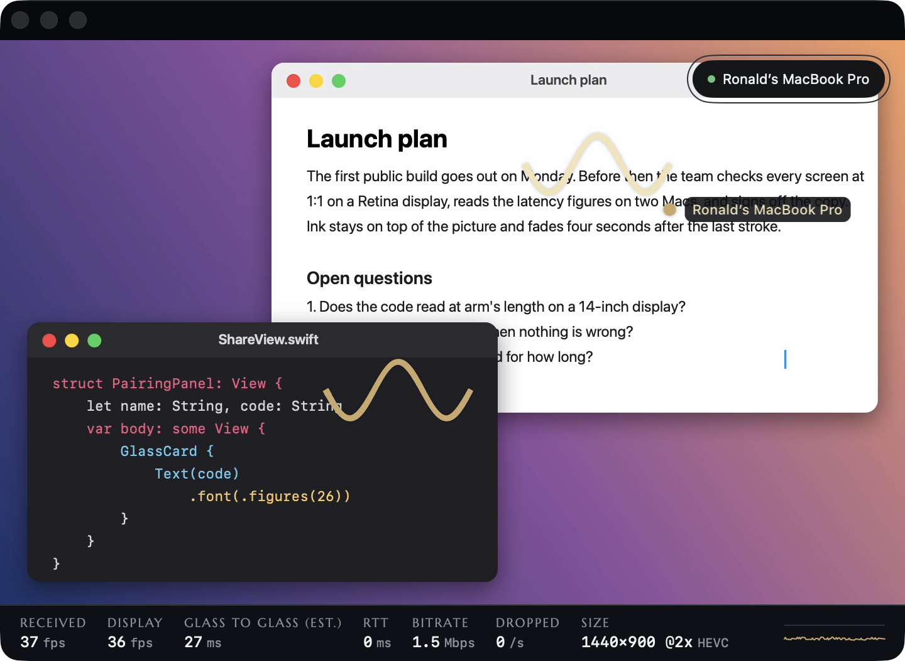
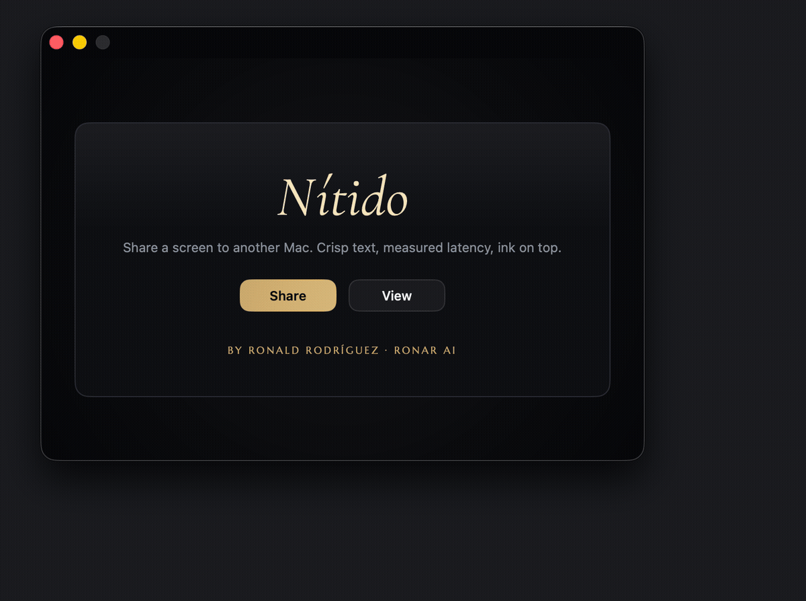
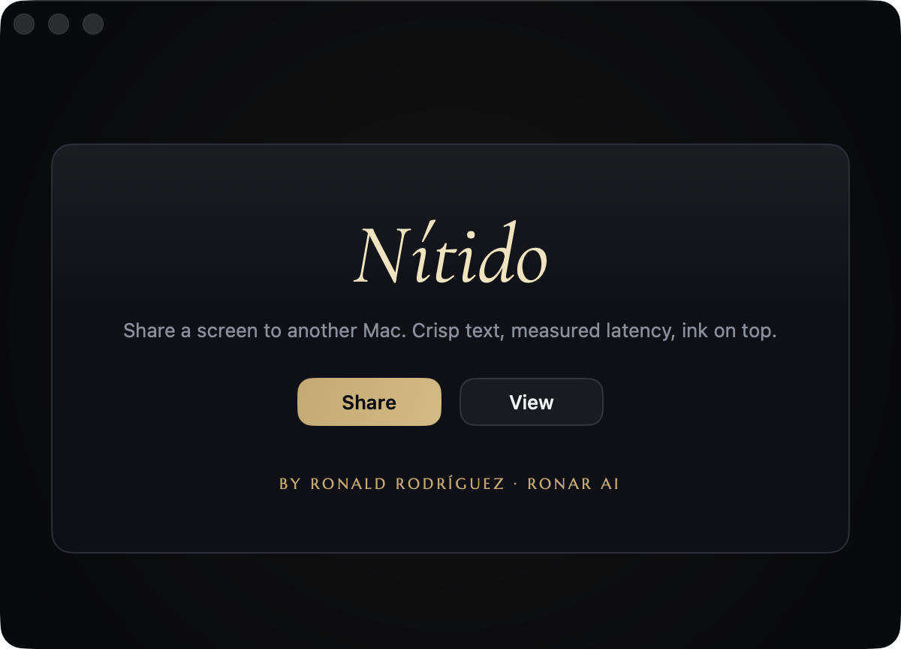
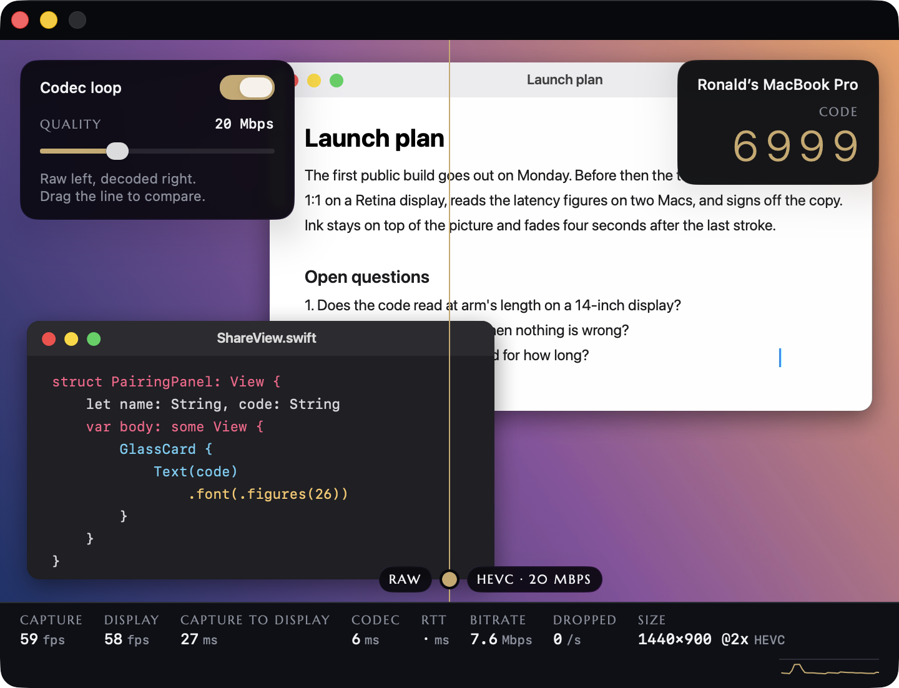
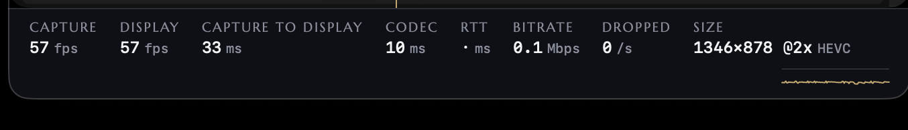

<!-- Before publishing: work through "Before publishing" in docs/testing.md; its step 3, scripts/check-readme.sh, must pass before the repository goes public. -->

# Nítido

A native macOS app that shares a window or a screen to another Mac on the local network, with crisp text, measured latency and ink on top. Swift 6.2, ScreenCaptureKit, VideoToolbox, Network.framework and Metal; no third-party code.



I built it in a week in October 2026, as a prototype of the core loop of a pair-programming tool: capture, encode, send, decode and draw a screen, and measure each step.

## What it does

- Shares a window or a display picked with the system picker, shown at native Retina scale, 1:1, also after the window is resized or the display changes mode.
- Runs a codec loop on one Mac: HEVC encode and decode with a quality slider (2 to 60 Mbps) and a divider you drag between the raw capture and the decoded picture, with the codec's cost in milliseconds.
- Pairs a second Mac with a 4-digit code (TLS 1.2 with a pre-shared key derived from it) and streams to it at up to 60 fps.
- Lets both sides draw on the picture: your strokes in gold, the other side's in cream, a fade four seconds after the last point, and ⌘Z and ⌘⌫ on both sides. Each side sees the other's pointer as a gold dot with its name.
- Shows the numbers in a strip under the picture: capture or received fps, display fps, capture to display (one Mac) or glass to glass (two Macs), codec time, RTT, bitrate, drops, size and codec.
- Survives a lost network: both sides say Reconnecting, the viewer retries with backoff and recovers with a keyframe, and the bitrate follows the send backlog and the RTT.



## Try it in a minute

Built for macOS 15 or later; tested on macOS 26.5. The zip runs on Apple silicon only.

**From the zip.** Download `Nitido-0.1-macOS15.zip` from the [releases page](https://github.com/ronald13ai/nitido/releases), unzip it and open `Nítido.app`. It is signed for development, not notarized, so macOS blocks it the first time: open System Settings, Privacy & Security, and click Open Anyway. (Since macOS 15, Control-click and Open no longer gets past this.) In Terminal, `xattr -dr com.apple.quarantine Nítido.app` does the same.

**From source.** You need Xcode 26 (Swift 6.2) and an Apple Development signing identity: in Xcode, Settings, Accounts, Manage Certificates makes one with a free Apple ID.

```bash
git clone https://github.com/ronald13ai/nitido && cd nitido
swift test                            # 354 tests (and 6 more behind NITIDO_RENDER=1 and NITIDO_SOAK=1)
swift scripts/make-icon.swift build   # optional: the app icon
scripts/bundle.sh                     # release build: build/Nítido.app, signed, and its zip
open build/Nítido.app
```

macOS keeps a Screen Recording grant only for a signed bundle, so share from the bundle; `swift run nitido` is fine for a look at the windows.

**On one Mac.** Click Share and pick a window. macOS asks for Screen Recording the first time; allow it, and choose Quit & Reopen if it offers that. Turn on the Codec loop switch (or press ⌘L) and drag the slider and the divider. For the network path, start a second copy with `open -n build/Nítido.app` (or `open -n Nítido.app` from the zip), click View in it (⌘⇧V), pick this Mac and type the code the first copy shows. The two copies talk over the same TLS link two Macs use.

**On two Macs.** Put both on the same network. Share on one, View on the other, pick the sharer by name and type its code. If macOS asks to let Nítido find devices on your local network, allow it on both Macs.



## Measured

Read from the telemetry strip on 2026-10-09. Sharer: MacBook Pro 14-inch, Apple M5, 120 Hz, macOS 26.5.2. Viewer: MacBook Air 13-inch, Apple M5, 60 Hz, macOS 26.5.1. Network: Wi-Fi 6 at 5 GHz.

| Scenario | Result | Build |
|---|---|---|
| Raw capture to display, window 1346×878 pt @2x (2692×1756 px) | 21 ms at 58 fps | 168b191 |
| Raw capture to display, full display 3024×1964 px | (fill in) ms | |
| Codec loop, HEVC at 2 Mbps, same window, text scrolling | codec 10 ms, capture to display 34 ms, real rate 1.5 Mbps, still text sharp | 168b191 |
| Codec loop, HEVC at 20 Mbps, same window | codec (fill in) ms, capture to display (fill in) ms | |
| Two Macs, glass to glass (estimated) | 30 to 40 ms | cae00eb |
| Two Macs, RTT | 9 to 10 ms | 168b191 |

- Capture to display is exact on one Mac: the capture time and the presentation time come from the same host clock.
- Glass to glass across two Macs is an estimate: it uses an NTP-style clock offset from the fastest pong of the last 10 s, and the strip labels it "(est.)".
- The spec aimed for capture to display under 20 ms through the codec loop. I measured 34 ms there at 2 Mbps, and 21 ms without the codec. Glass to glass met its target of under 100 ms.
- At 2 Mbps the encoder kept to the limit (1.5 Mbps real), and still text stayed sharp. Whether it stays sharp while it scrolls is still to be checked.
- Both two-Mac runs came before the fixes made after the evening run (the backlog rule, the keyframe limit, the pacer's cadence check) and are to be re-measured. The first run (168b191) read 46 ms while the Air showed 33 of 58 fps (bug 2 below).





## How it works

One Swift package: five library targets, a thin app target, and a test-support target under `Tests/`.

**`NitidoCore`** has no Apple UI frameworks (Foundation and CryptoKit only), and all of it is unit-tested. It holds the wire format (big-endian, a 5-byte `u32 length · u8 type` header, 11 message types, payloads capped at 16 MiB, unknown types skipped by length), rolling one-second telemetry with p50 and p95, the bitrate controller, the sender's backlog rule (`BacklogPolicy`), the half-second keyframe limit (`KeyframeLimiter`), the minimum-RTT clock-offset filter, ink geometry (Catmull-Rom smoothing, speed to width, fade, undo) and the HKDF pairing key.

**`NitidoCapture`** wraps `SCContentSharingPicker` and `SCStream`: native pixel size, up to 60 fps, BGRA, cursor shown. Nítido's own windows are left out of the picker, and a shared display is captured without the Nítido app, so its windows and sheets never show in the picture. When the content changes size, the stream restarts at the new size once it has held for 150 ms. Start, update and stop run one at a time, so a quick re-pick never races a stream being torn down.

**`NitidoCodec`** wraps VideoToolbox in realtime mode with no frame reordering: HEVC Main, or H.264 High when there is no hardware HEVC encoder, with a keyframe every 120 frames or on request. The stream is tagged BT.709 with the sRGB transfer function, and the decoder hands its 4:2:0 pictures to Core Image, which converts them on the GPU as it draws.

**`NitidoLink`** wraps Network.framework: a Bonjour `_nitido._tcp` listener and browser, and one TLS connection per peer for both directions. A ping every 500 ms gives the RTT and the clock offset; a link with no pong for 3 s fails. The sharer publishes its port and IPv4 addresses in its TXT record, and the viewer dials up to two of them, then the Bonjour service, within 8 s. After a drop the viewer reconnects with backoff (0.5, 1, 2 and 4 s, then every 5 s), each time to where discovery says the sharer is now. Both sides say hello with their protocol version first, and a mismatch ends the session with a message naming both versions.

**`NitidoUI`** holds the models and the windows. `VideoView` draws into a `CAMetalLayer` through Core Image: 1:1 when the window allows it, a Lanczos downscale when it does not, never an upscale. `FramePacer` keeps only the newest frame and as few drawables in flight as the display needs, because each drawable queued ahead of a frame delays it by a refresh ([`FramePacer.swift`](Sources/NitidoUI/FramePacer.swift) explains how many). `InkOverlay` draws strokes as variable-width ribbons over the video, and `TelemetryStrip` reads a snapshot four times a second. Drawing the held frame again after a resize never counts as a displayed frame, so the fps and latency figures count only frames that reached the screen.

**`nitido`** is the app: one window, the menus, and a quit that tells the other Mac `bye` before the process ends (2 s at most). It has no logic of its own.

Every stage drops work instead of queueing it:

- Capture keeps only the newest frame.
- The encoder takes two frames at a time; of the frames it turns away, only the newest goes in next.
- A frame VideoToolbox drops counts as a drop; only ten real encode errors in a row stop the codec.
- The sharer skips deltas once its send backlog stays over 150 ms worth for 100 ms, or passes 1 s worth.
- The sharer forces at most one keyframe per half second per viewer; a new viewer's first goes at once.
- A message for a link that is not up is dropped, not queued.
- The viewer's decoder skips to the next keyframe once the oldest waiting frame is 50 ms old or eight wait.
- Only the newest decoded frame waits for the main thread.

One wait is left: frames that reach the viewer while its main thread is busy wait in the link's message stream. When they come in a burst, the decoder takes eight and skips the rest to the next keyframe.

Every 250 ms the bitrate controller reads the RTT (the last second's median, or how long an unanswered ping has waited, if that is longer) and the send backlog. It cuts 25% when the backlog passes two frames' worth, the RTT climbs 40 ms above its 10-second minimum, or the sender started skipping, then holds for 2 s (a new skip cuts even then). It adds 10% at most every 2 s while the backlog stays under one frame and the RTT within 15 ms of its minimum. It keeps between 2 and 60 Mbps and starts at 20 Mbps for 1080p, scaled by pixel count (45.6 Mbps for the 2692×1756 px window above). The design spec and the implementation plan are in `docs/superpowers/`.

## What I found by testing on two Macs

On 2026-10-09 I ran Nítido on two Macs for the first time: the MacBook Pro sharing to the MacBook Air over Wi-Fi. These are the bugs that session found, and what I changed.

1. **A wrong code looked like a dead network.** The viewer waited out its 15 s deadline instead of saying "Wrong code", and the sharer counted one attempt as three or four failed handshakes, so one typo changed its code.\
   Fix: the viewer dials the addresses the sharer publishes, so the TLS failure comes back at once, and the sharer counts failures from one address less than 1 s apart as one attempt. That evening the viewer said "Wrong code" at once.
2. **The 60 Hz viewer showed 33 of 58 fps.** With one drawable in flight a frame costs two refreshes, so a 60 Hz panel showed every other frame; the ProMotion sharer starved the same way, because its screen said 120 Hz while presenting at 60.\
   Fix: two drawables in flight on a panel slower than twice the capture rate, a check of the real presentation cadence every second, and only the newest decoded frame waiting for the main thread. That evening the Air logged no more "fell behind" lines and showed glass to glass 30 to 40 ms.
3. **Colours were slightly off on the viewer.** The encoder set no colour tags, so the decoder read the capture's sRGB values as BT.709.\
   Fix: the stream is tagged BT.709 primaries and matrix with the sRGB transfer function. A test on one Mac went from up to 12 code values off to within 2. On the evening build, which had the tags, the Air's colours still looked slightly different by eye; the Digital Color Meter check ([docs/testing.md](docs/testing.md) item 27) will tell the codec apart from the two displays' profiles.
4. **The backlog rule turned into a keyframe slideshow.** While a long window scrolled, the sharer showed 58 fps and the viewer 10 to 48: one Wi-Fi burst tripped a skip, and the keyframe that ended it tripped the next, every 50 to 100 ms.\
   Fix: `BacklogPolicy` judges the backlog in time (150 ms worth for 100 ms, or 1 s worth at once) without the keyframe on its way, and `KeyframeLimiter` forces at most one keyframe per half second per viewer.
5. **VideoToolbox's drops failed the share.** Under that keyframe storm the realtime encoder dropped ten frames in a row, and the app counted each as a failure: "Video encoding keeps failing."\
   Fix: a dropped frame counts in the strip and is logged at most once a second; only ten real encode errors in a row stop the codec.
6. **The app crashed on a second share.** After one share stopped and another started, SwiftUI kept the ink canvas for the new share, but the canvas still held the old share's controller `unowned`, and its 30 Hz timer called into it after it was freed.\
   Fix: the canvas holds its controller weakly, follows the one it is handed, and ticks only while it is in a window. Tests reproduce the switch.

Fixes 4, 5 and 6, and the ProMotion half of 2, came after that session. Each has tests, but none has run on the Macs yet: items 16 and 24 to 26 of [docs/testing.md](docs/testing.md) check them.

## Security

Pairing uses TLS 1.2 with a pre-shared key derived with HKDF-SHA256 from the 4-digit code and the sharer's name. The only ciphersuite offered is `TLS_ECDHE_PSK_WITH_CHACHA20_POLY1305_SHA256`, and a test checks it is the one negotiated.

- Someone who only records the traffic cannot decrypt it, not even after learning the code later, because of the ephemeral key exchange.
- A wrong code fails the handshake, and three wrong codes change the code. The sharer counts attempts, not handshakes: failures from one address less than a second apart are one attempt, up to four. So the code changes by the ninth failed handshake from one address at the latest, and a port scan or a connection cut short counts for nothing.
- At most eight connections prove the code at once, three from one address.
- Only the local network reaches the code: a connection over a VPN tunnel or cellular, or from a public address on none of the sharer's networks (a globally routable IPv6 address, say), is closed before its handshake and logged. Private addresses on another VLAN of the same network still get through.

What it does not protect against:

- Each blind guess has a 1 in 10,000 chance, and a host on the network can fail handshakes on purpose to keep the code changing, so that nobody can pair.
- An active attacker on the same network can pose as the sharer, test all 10,000 codes against the viewer's half of the handshake in milliseconds and relay the stream. The rotation does not help, because that attack never fails a handshake.

So the 4-digit code is for a network you trust (home, office), not public Wi-Fi. The next step is a PAKE such as SPAKE2, where each active attempt tests one guess, or a 128-bit secret shared by QR code; section 13 of the design spec has the details.

## Testing

`swift test` runs 354 XCTest tests, with no failures at the current commit (just under three minutes on an M5 once built); 6 more, the render gallery and the soak tests, run only with NITIDO_RENDER=1 or NITIDO_SOAK=1.

- `NitidoCore` (56): wire round-trips and decoding fed byte by byte, telemetry percentiles, the bitrate controller, the backlog rule, the keyframe limit, the clock-offset filter, ink geometry and the pairing key.
- `NitidoCodec` (20): encode and decode loops on real VideoToolbox sessions, keyframe requests, the decoder's skip rule, colour tags, failure reporting and the rate cap on a dense scrolling page.
- `NitidoLink` (49): real TLS connections on this Mac (frames both ways, a wrong code, the negotiated ciphersuite, reconnects), the TXT record and the order of routes.
- `NitidoCapture` (16): restarts after a resize or a display mode change, the serial start and stop, and the capture clock.
- `NitidoUI` (213): the frame pacer against a fake display, the sharer and the viewer end to end over a real link with a stand-in capture source, colours through the codec, ink, window sizes and menus.

The picker and the Screen Recording grant, what reaches a real screen, and two real Macs are checked by hand: [docs/testing.md](docs/testing.md) is the checklist, one action and one expected result per item.

## Limits and what's next

- Local network only: discovery is Bonjour and there is no NAT traversal. Next: WebRTC with STUN/TURN for the open internet.
- One viewer at a time: a second viewer that proves the code takes the seat, and the first is told so.
- The 4-digit code is safe only on a trusted network (see Security). Next: SPAKE2 or a secret shared by QR code.
- The build is signed for development, not notarized.
- No audio, no remote control, no recording.
- Next for the picture: coding text regions at higher quality than photos, so small text stays sharp at low bitrates, and AV1 where the hardware encodes it.
- Still to check by hand: text at 2 Mbps while it scrolls, colours between two Macs with Digital Color Meter, and, on the Macs, fixes 4, 5 and 6 and the ProMotion half of 2.

## License

MIT. Fonts: Cormorant Garamond and Marcellus under the SIL Open Font License (see `Sources/NitidoUI/Fonts`).

Built by Ronald Rodríguez, RONAR AI, Turin, October 2026.
